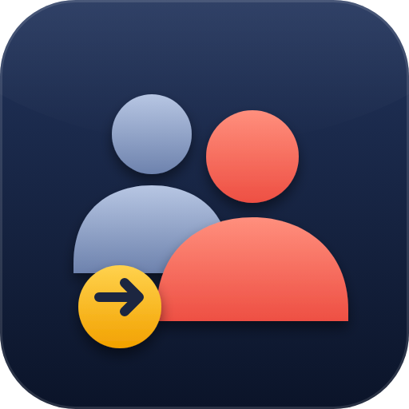

# FG Login as User (pkg_fgloginasuser)

Native **Joomla 6** extension for administrators, part of the FG extension series: log in as another user to check what they see, reproduce a problem, or test permissions - to the **frontend** or to the **backend**.

Package `pkg_fgloginasuser` = component `com_fgloginasuser` + system plugin `plg_system_fgloginasuser` (return bar and buttons in the core Users list) + action log plugin `plg_actionlog_fgloginasuser` (Joomla *User Actions Log* integration).

## Features

- **Frontend login** - opens the site as the user (new tab by default). The site session is separate from your administrator session, so the administration stays open.
- **Backend login** - switches your administrator session to another backend user in place (useful for testing what a Manager sees). A bar at the bottom of every page offers *Return to my account*.
- **Buttons in the core *Users* list** (`com_users`) - the same buttons (compact labels, full text as tooltip), with the same permission and restriction checks, appear in their own *Login as* column after *Username*. Can be switched off in the system plugin options.
- **Joomla User Actions Log** - started / ended / denied logins are written to *Users -> User Actions Log* (filterable by extension). Disable the action log plugin to stop writing.
- Users screen with search / group / status filters; unavailable actions are greyed out with the reason in a tooltip.
- Permissions per Joomla user group (Options -> Permissions): *Login to frontend as user*, *Login to backend as user*. Super Users are always allowed.
- Optional restrictions: members of group A may only log in as members of groups X, Y.
- Audit log of every attempt (also denied ones), filters, delete, purge, retention in days.
- Optional e-mail notification (uses Joomla's mailer, so SMTP works on hosts without PHP `mail()`).
- Custom button text (`%s` = username), redirect after login (menu item or URL), custom CSS.

> The `com_users` buttons are injected into the rendered page HTML (Joomla has no event for extra row content in that list). If a future core template changes, the injection fails silently and the buttons simply do not appear; the extension's own Users screen keeps working.

## Requirements

Joomla 6.0+, PHP 8.3+, MySQL / MariaDB. Developed and tested on Joomla 6.1.2.

## Installation

Download `pkg_fgloginasuser_vX.X.X.zip` from the [latest release](https://github.com/FGcodework/pkg_fgloginasuser/releases/latest) and install it through *System -> Install -> Extensions*. The plugin is enabled automatically on a fresh install. Then grant the permissions: *Users -> Login as User -> Options -> Permissions* (give the group `Access Administration Interface` plus one or both login actions).

Updates are announced by Joomla itself (*System -> Update -> Extensions*) through the update server `updates.xml` in this repository, and are also picked up by [FG Extension Manager](https://github.com/FGcodework/com_fgextensionmanager).

## Security model

| Rule | Detail |
| --- | --- |
| CSRF | Starting an impersonation is POST-only with a Joomla form token; stopping needs the session token. |
| Frontend token | 256 random bits, DB stores only its SHA-256, single use (atomic `UPDATE ... WHERE status='pending'`), default 60 s, optionally bound to the requesting IP, response sent with `Cache-Control: no-store` and `Referrer-Policy: no-referrer`. Permissions are re-evaluated when the token is used. |
| Targets | Never yourself, never blocked or non-activated users, only users allowed to log in on that client (`core.login.site` / `core.login.admin`). |
| Super Users | Only another Super User can log in as a Super User, and only when *Allow impersonating Super Users* is on (off by default). |
| Restrictions | Rows in Options -> Security limit which groups an administrator group may log in as. Super Users are never restricted. A row with no target groups allows nobody. |
| Session | `lastvisitDate` of the target is not modified, session id is regenerated, the old session row is deleted, the MFA captive page is skipped for the impersonated session. |
| Ending | Only the current session is destroyed - not core `logout()`, which would also terminate the real user's own sessions. |

Things to know:

- The one-time token is part of a URL for a few seconds, so it can appear in the web server access log - it is useless after first use or expiry.
- A **backend** switch changes the session of that browser, so other administrator tabs in the same browser are switched as well.
- If your connection alternates between IPv4 and IPv6 between the administrator and the site request, turn off *Bind login link to IP address*.
- While impersonating a user in the backend, an impersonated user without access to this component can still leave via the bar (the *stop* task is exempt from `core.manage`, but only while the session carries an impersonation marker).

## Not included

- Buttons inside third-party shop/membership lists (HikaShop, J2Store, VirtueMart, Community Builder ...). The extension has its own Users screen.
- PostgreSQL schema.

## Tests

`tests/audit.py` (26 checks) holds the regression tests for the findings of the 1.0.5 security review (shared sessions, actor revalidation, group inheritance, forced password reset, logout in an impersonated session, audit-table outage, log permissions, purge); it reuses the helpers of `e2e.py`. `tests/logstore_probe.php <joomla-root> <actorId> <targetId>` checks the token claim / refusal race against the real database. `tests/browser_click.py` additionally clicks the real buttons in Chromium (Playwright). `tests/e2e.py` is the browser-like end-to-end suite used for the release (133 checks: both targets, ACL, restrictions, token replay / expiry / IP mismatch / junk, CSRF, MFA, parallel real sessions, mail, retention, `com_users` list buttons, User Actions Log, PHP warnings). It expects a throw-away Joomla at `http://127.0.0.1:8080` with the users `root`, `alice`, `bob`, `carol` (Manager), `mike` (Manager), `dave` (blocked), `sue` (Super User) - see the top of the script.

## Repository layout

| Path | What |
| --- | --- |
| `pkg_fgloginasuser.xml`, `script.php`, `language/` | Package manifest, install script (preflight checks, plugin enabling), package language files |
| `com_fgloginasuser/` | Component (administrator + site + media) |
| `plg_system_fgloginasuser/` | System plugin: return bar, buttons and *Login as* column in `com_users` |
| `plg_actionlog_fgloginasuser/` | Action log plugin: language strings for the User Actions Log |
| `tests/` | End-to-end suite (`e2e.py`), review regression tests (`audit.py`, `logstore_probe.php`) and real-browser click test (`browser_click.py`) |
| `build.sh` | Builds `dist/pkg_fgloginasuser_vX.X.X.zip` and regenerates `updates.xml` |
| `updates.xml` | Joomla update server feed (generated) |

## Releasing

1. Bump `<version>` in all four manifests, add a `## X.X.X - date` entry to `CHANGELOG.md`.
2. Run `./build.sh` (checks that the versions agree, builds the ZIP, regenerates `updates.xml`) and commit.
3. Tag and push: `git tag vX.X.X && git push origin master vX.X.X`. The *Release* workflow lints the sources, verifies that tag, manifest and `updates.xml` agree, and publishes the GitHub release with the ZIP attached.

## Support

If you like this extension, you can support its development on [Ko-fi](https://ko-fi.com/fgcodework). More FG extensions: [fgcodework.github.io](https://fgcodework.github.io).

## License

GNU General Public License version 2 or later - see [LICENSE](LICENSE).

## About

Part of the FG extension series by [FGcodework](https://github.com/FGcodework). Inspired by the idea of the Web357 *Login as User* component; this is an independent implementation written for Joomla 6 and works on the backend as well.

## Known limitations

- The one-time login link carries a bearer token in the URL (valid 60 s, single use, bound to the IP by default).
- No absolute time limit on an impersonation, no mandatory reason / ticket field and no step-up authentication; candidates for a later release.
- Viewing the audit log needs the separate permission `Log` (`fgloginasuser.logs`).
